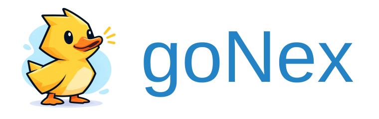

<p align="center">
  <a href="https://amkargar.github.io/GoNex-website/">
    
  </a>
</p>

<p align="center">
  <a href="https://amkargar.github.io/GoNex-website/"><strong>Website</strong></a> ·
  <a href="https://amkargar.github.io/GoNex-website/docs/main/">Documentation</a> ·
  <a href="https://amkargar.github.io/GoNex-website/docs/main/quick-start/">Get started</a> ·
  <a href="https://amkargar.github.io/GoNex-website/docs/main/contribute/">Contribute</a>
</p>

[](https://go.dev/)
[](https://github.com/amkargar/gonex/actions/workflows/test.yml)
[](https://amkargar.github.io/GoNex-website/docs/main/)
[](LICENSE)

**Gonex is an API-first Go framework for building modular JSON APIs.** It brings together typed request and response schemas, validation, OpenAPI and a project CLI, while keeping your business logic in plain Go. Gonex is free and open source.

Its DRF-inspired workflow starts with your application: install Gonex, generate a project, add modules and develop your API. Persistence, HTTP versioning, gRPC and microservices are available when you need them.

## Documentation

- [Install Gonex and its CLI](https://amkargar.github.io/GoNex-website/docs/main/installation/)
- [Create your first API project](https://amkargar.github.io/GoNex-website/docs/main/quick-start/)
- [Build a REST API](https://amkargar.github.io/GoNex-website/docs/main/building-api/)
- [Browse the documentation](https://amkargar.github.io/GoNex-website/docs/main/)
- [CLI reference](https://amkargar.github.io/GoNex-website/docs/main/cli/)
- [Server output and logging](https://amkargar.github.io/GoNex-website/docs/main/logging/)

Visit the **[Gonex website](https://amkargar.github.io/GoNex-website/)** for an introduction, code examples and the [project journal](https://amkargar.github.io/GoNex-website/blog/). Documentation includes a version selector; application HTTP API versions are configured separately.

## Get started

Requires **Go 1.27.2**. Install the CLI, then create your own application:

```sh
go install github.com/amkargar/gonex/cmd/gonex@main
gonex new shop --module example.com/acme/shop
cd shop
go mod tidy
go tool gonex create module users
go tool gonex check
go tool gonex run
```

Ensure Go's binary installation directory is on PATH. After project creation, use `go tool gonex` to run the CLI version tracked by your application's `go.mod`.

Open [http://127.0.0.1:8080/users](http://127.0.0.1:8080/users) for the starter response:

```json
{"message":"users"}
```

The terminal displays the server URL and request logs. Your API contract is available at [http://127.0.0.1:8080/openapi.json](http://127.0.0.1:8080/openapi.json). Press Ctrl+C to stop gracefully.

**Development status:** Gonex has no published release yet. `@main` installs a development snapshot; use a reviewed commit or an actual published tag to select a particular version. Generated projects pin the installed CLI's resolved framework version. See the [release status](https://amkargar.github.io/GoNex-website/docs/main/release/) and [changelog](CHANGELOG.md).

## About Gonex

### APIs with a clear contract

Define request and response DTOs in `schemas.go`, map requests in handlers, and register typed endpoints with explicit methods and statuses. Strict JSON binding, validation and OpenAPI 3.1 describe the API you implement. See [HTTP contracts](https://amkargar.github.io/GoNex-website/docs/main/http/).

### A productive development workflow

The CLI creates projects, modules and optional adapters. Generated registries are protected against conflicting edits; handwritten services, schemas and handlers remain yours. The [REST API tutorial](https://amkargar.github.io/GoNex-website/docs/main/building-api/) develops create, list and get actions inside a generated application.

### Plain Go at the center

Modules compose services explicitly. Gin HTTP handlers, optional GORM repositories and gRPC adapters translate at the boundaries. Start with a modular monolith and add integrations as the application grows. Read the [architecture guide](https://amkargar.github.io/GoNex-website/docs/main/architecture/) or explore the [source examples](examples/).

### Visibility while you build and run

Application startup reports the bound server address. Structured request logs include a request ID, status and duration, with readable development output and JSON in production. Managed resources, health checks, readiness and graceful shutdown support the application lifecycle. See [logging](https://amkargar.github.io/GoNex-website/docs/main/logging/) and [operations](https://amkargar.github.io/GoNex-website/docs/main/operations/).

## Production readiness

Hardening, verification commands and outstanding release gates are tracked in the [production-readiness reports](docs/production-readiness/README.md). The [final readiness decision](docs/production-readiness/final-report.md) distinguishes passing technical checks from owner/reviewer and release evidence.

## Contributing

Contributions are welcome. Start with [Contribute to Gonex](https://amkargar.github.io/GoNex-website/docs/main/contribute/) for framework setup, architecture, testing and pull requests. The [source documentation index](docs/README.md) contains implementation references and maintenance guides.

Use [GitHub Issues](https://github.com/amkargar/gonex/issues) to report reproducible bugs or discuss improvements. Review [compatibility and upgrades](docs/upgrade.md) and the [release policy](docs/release.md) when changing public contracts.

## License

Gonex is released under the [BSD 3-Clause License](LICENSE).

## Local microservices, explicitly wired

Create independent HTTP/gRPC/worker services with a strict local catalog, typed clients, gonex doctor and gonex dev. Follow the [Orders → Identity tutorial](docs/microservices-dx/quickstart.md); business mapping stays explicit and contracts must be published before isolated deployment. No framework clone or required distributed runtime is needed.
